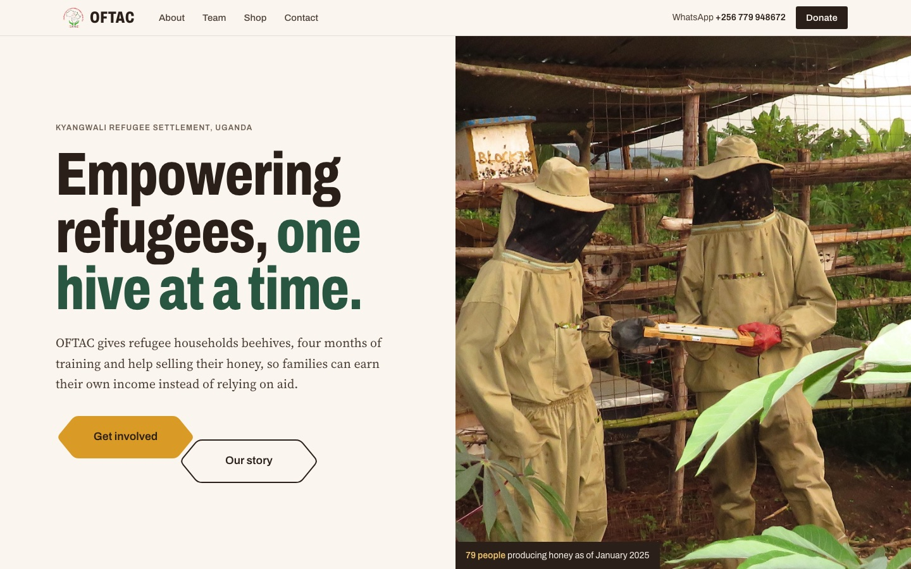
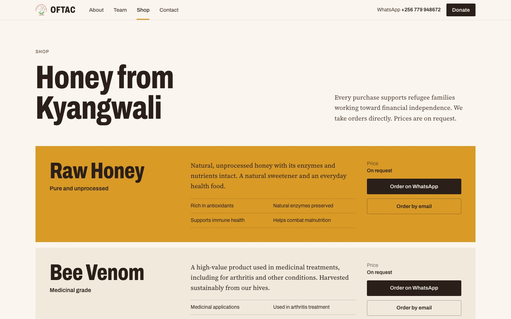
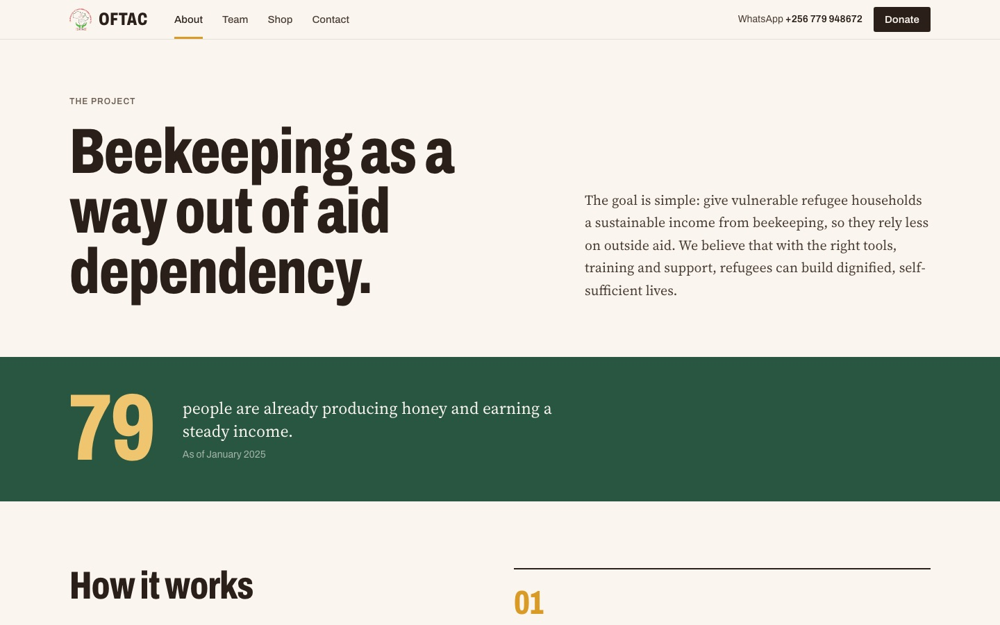
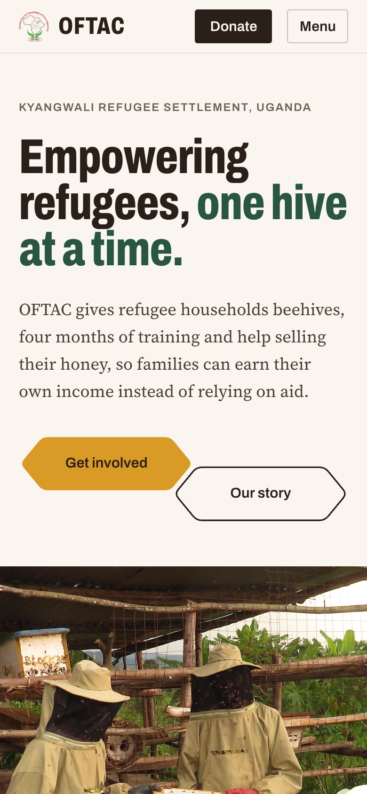
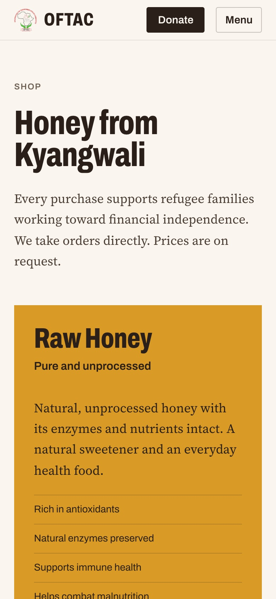

# OFTAC: Organization for Transforming African Communities

Website for OFTAC, a community-based organization that helps refugee families in the Kyangwali settlement in Uganda build sustainable incomes through beekeeping. The site tells the project's story, introduces the team, lists honey products, and explains how to donate.

**Live site:** https://oftac.netlify.app



<table>
  <tr>
    <td width="50%"></td>
    <td width="50%"></td>
  </tr>
  <tr>
    <td align="center">Shop</td>
    <td align="center">About</td>
  </tr>
</table>

<table>
  <tr>
    <td align="center"><br>Home on a phone</td>
    <td align="center"><br>Shop on a phone</td>
  </tr>
</table>

## Who it's for

- **Donors and supporters** who want to understand the project and give by Mobile Money or bank transfer
- **Customers** looking to order honey and hive products
- **Partners and NGOs** looking for an overview of OFTAC's work and team

## My role

I designed and built the site end to end: information architecture, UI, content layout, and Netlify deployment. I also replaced an early Flutterwave checkout that never worked in production with a simpler contact-based donation flow.

## Tech stack

| Layer      | Choice                                                    |
| ---------- | --------------------------------------------------------- |
| Framework  | React 19 + TypeScript                                     |
| Build tool | Vite 8                                                    |
| Routing    | React Router 8                                            |
| Styling    | Tailwind CSS 4, no component library                      |
| Type       | Archivo (display, UI) and Source Serif 4 (body), Google Fonts |
| Hosting    | Netlify (static, auto-deploys from `main`)                |
| CI         | GitHub Actions: lint, typecheck, build                    |

## Architecture

The site is a static single-page app with no backend and no environment variables.

```
Browser ──► Netlify CDN ──► index.html + hashed JS/CSS bundles
                               │
                               └─ React Router renders one page component per route
                                  (/, /about, /team, /shop, /contact, /donate, 404)
```

- `public/_redirects` sends every path to `index.html` so deep links work with client-side routing.
- Donations and shop orders open WhatsApp or a pre-filled email. The site takes no payments directly, so it holds no payment keys.
- Contact details and the WhatsApp/email link helpers live in a single module (`src/lib/contact.ts`) used across the site.

```
public/               _redirects, og-image.jpg, favicon.ico, robots.txt
src/
  main.tsx            Entry point
  App.tsx             Route table
  index.css           Tailwind import, colour tokens (ink, paper, honey, forest), type and button utilities
  pages/              One component per route
  components/         Layout (shared shell), Header, Footer, HexButtons
  lib/                contact.ts
  assets/             Images bundled by Vite
```

## Local setup

Requires Node.js 20.19+ or 22.12+ (see `.nvmrc`) and npm.

```bash
git clone https://github.com/anujmish1229/oftac.git
cd oftac
nvm use        # optional, picks up .nvmrc
npm install
npm run dev    # http://localhost:8080
```

| Script              | What it does                          |
| ------------------- | ------------------------------------- |
| `npm run dev`       | Dev server with hot reload            |
| `npm run build`     | Production build into `dist/`         |
| `npm run preview`   | Serve the production build locally    |
| `npm run lint`      | ESLint                                |
| `npm run typecheck` | TypeScript type check                 |

## Environment variables

None. The site is fully static.
